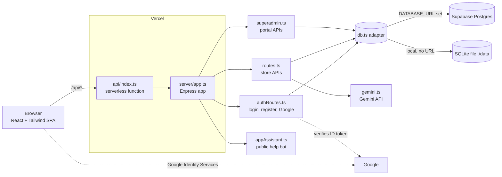
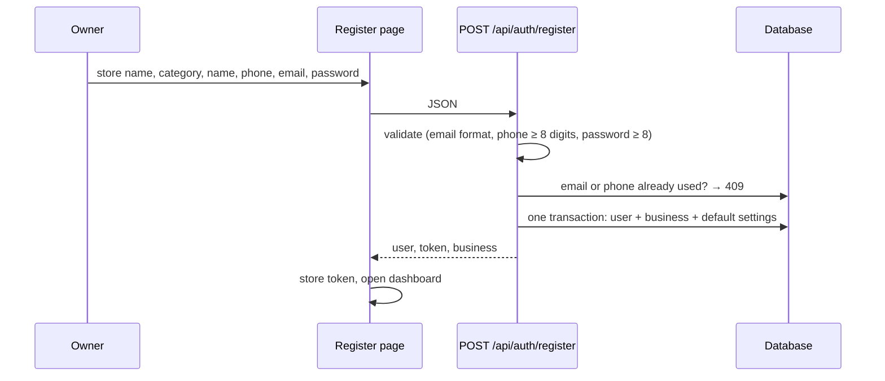
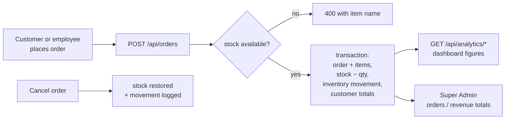

# ShopMate AI — Project Guide

How the project works, how its parts connect, and how to test every part of it, step by step.

- [1. What ShopMate AI is](#1-what-shopmate-ai-is)
- [2. The four kinds of people (roles)](#2-the-four-kinds-of-people-roles)
- [3. Architecture](#3-architecture)
- [4. How the workflows connect](#4-how-the-workflows-connect)
- [5. Data model](#5-data-model)
- [6. Security model](#6-security-model)
- [7. Configuration (environment variables)](#7-configuration-environment-variables)
- [8. Running it](#8-running-it)
- [9. Testing guide](#9-testing-guide)
- [10. Troubleshooting](#10-troubleshooting)

---

## 1. What ShopMate AI is

A multi-tenant retail SaaS. Each **business (store)** gets its own private workspace: product catalogue, inventory,
customers, orders, staff accounts, analytics and an AI shopping assistant. One platform operator (the **Super Admin**)
can watch the whole platform from a separate portal.

| Surface | URL | Who uses it |
|---|---|---|
| Public site + "ShopMate AI" help assistant | `/` | Anyone (answers questions about the app only, no cart) |
| Login / Register (email or Google) | `/` → Sign In / Register Business | Store owners, employees, customers |
| Store dashboard, inventory, orders, customers, analytics, settings | `/` after login | Owner / employee |
| Customer shopping page with the store's AI assistant | `/` after customer login | Customers |
| Super Admin Panel | `/superadmin` | Platform operator only |

## 2. The four kinds of people (roles)

| Role | Created by | Can do |
|---|---|---|
| `BUSINESS_OWNER` | Registering a business (email form or Google) | Everything inside their own store, including staff and settings |
| `EMPLOYEE` | Owner (Employees page) | Billing, orders, inventory — limited by role checks |
| `CUSTOMER` | Registering as a shopper / one-click demo | Browse the store, chat with its assistant, place orders |
| `SUPER_ADMIN` | Server start-up from `SUPERADMIN_EMAIL` / `SUPERADMIN_PASSWORD` | Read-only view of all real tenants in `/superadmin` |

**Demo personas** (one-click on the Login page) create/open sandbox users with `is_demo = 1` inside a shared demo store
(`biz_demo_store_001`). They need no credentials and are hidden from the Super Admin numbers unless "include demo"
is switched on.

## 3. Architecture



Key points

- **One Express app, two hosts.** `server.ts` runs it locally (with Vite for the UI); `api/index.ts` exports the same
  app as a Vercel serverless function. `vercel.json` rewrites `/api/*` to the function and everything else to the SPA.
- **One SQL dialect for the code, two databases.** `server/db.ts` exposes an async `db.prepare(sql).get/all/run` API.
  With `DATABASE_URL` it talks to Postgres; without it, to a local SQLite file. Tables are created automatically on
  first start (`server/bootstrap.ts`, `database/schema.sql` is the reference copy).
- **Stateless sessions.** After login the server returns a signed token (`shp.<payload>.<signature>`, 7 days; the
  Super Admin portal token lasts 12 hours). Nothing is stored in server memory, so serverless instances need no
  shared session store.
- **AI is optional glue, not the foundation.** Inventory, orders and the help assistant work without any AI key;
  only the per-store chat/recommendation features call Gemini (`GEMINI_API_KEY`).

### Folder map

```
api/index.ts            Vercel entry (exports the Express app)
server.ts               Local dev entry (Express + Vite middleware)
server/app.ts           App assembly: JSON parsing, health, routers, global error handler
server/authRoutes.ts    /api/auth/*  register, login, demo-login, Google, me, password reset
server/accounts.ts      Validation + creation of owners/customers, login-event logging
server/auth.ts          Token signing, password hashing, auth middleware, role checks, rate limiter
server/routes.ts        Store APIs: products, inventory, orders, customers, analytics, AI, settings
server/superadmin.ts    /api/superadmin/*  platform-wide, read-only, demo-aware
server/appAssistant.ts  Public "ShopMate AI" help bot (app questions only)
server/db.ts            Postgres/SQLite adapter, transactions, schema versioning, row-level security
server/seed.ts          Demo store data
src/                    React app (pages, components, context, services)
database/schema.sql     Reference schema
docs/                   This guide, architecture, API, deployment
server/api_test.ts      Automated end-to-end API tests (npm run test:api)
```

## 4. How the workflows connect

### 4.1 Registration (email)



Email and phone are unique per account. The business, its owner and its defaults are created in a single
transaction, so a failure never leaves a half-created store.

### 4.2 Registration and login with Google ("Google first, details after")

```mermaid
sequenceDiagram
  participant U as Person
  participant UI as Login / Register page
  participant G as Google
  participant API as POST /api/auth/google
  U->>UI: click "Sign up / Sign in with Google"
  UI->>G: popup consent
  G-->>UI: ID token (credential)
  UI->>API: {credential, mode:"register"}  (no store name or phone)
  API->>G: verify token (audience = GOOGLE_CLIENT_ID, email verified)
  alt account already exists
    API-->>UI: user + token (signed in; Google linked to the account)
  else new Google user
    API-->>UI: {needsProfile:true, profile} — nothing is created yet
    UI->>U: "One last step" form: store name, category, phone
    U->>UI: submit
    UI->>API: {credential, mode:"register", businessName, phone, ...}
    API-->>UI: 201 user + token + business
  end
```

- Nothing is stored until the details step is submitted, so abandoning it leaves no half-account.
- The same Google credential is re-used for the second call (it is valid for about an hour). If it expired, the
  user simply clicks the Google button again.
- Signing in with Google on the Login page for an unknown Google account takes the person to the same details form.
- A Google account whose email already belongs to an email/password account is linked to it on first Google sign-in.
  An email linked to a *different* Google account is refused (409).

### 4.3 Login and demo personas

`POST /api/auth/login` checks the password (scrypt; old SHA-256 hashes are upgraded transparently), is rate-limited
per IP+email, returns the same generic error for "unknown email" and "wrong password", and records a row in
`login_events` (this feeds the Super Admin "Logins" tab). `POST /api/auth/demo-login` opens a sandbox persona without
credentials.

### 4.4 Tenant isolation (how one store never sees another)

Every store API goes through `authMiddleware` and then `resolveBusinessId`, which takes the business from the signed
token, never from the request. Only anonymous browsing or a Super Admin may pick a store with the `x-business-id`
header. Every query is filtered by `business_id`, and all tables also have Postgres row-level security enabled as a
second layer.

### 4.5 Order → inventory → analytics



### 4.6 Store assistant vs. public "ShopMate AI" assistant

| | Public assistant (outer page) | Store assistant (inside a store) |
|---|---|---|
| Endpoint | `POST /api/ai/assistant` | `POST /api/ai/chat` |
| Knows | The ShopMate AI app itself (features, registration, roles, security…) | That store's products, stock and orders |
| Cart / ordering | No | Yes |
| Name and suggested questions | Fixed: "ShopMate AI" | Editable per store in **Settings** |
| AI key needed | No (rule-based, refuses off-topic questions) | Yes (Gemini) |

### 4.7 Super Admin Panel

`/superadmin` is a separate sign-in (password or the allowed Google account). The portal token is only accepted by
`/api/superadmin/*`, and every route re-checks that the user is a real (non-demo) `SUPER_ADMIN`.

| Tab | Endpoint | Shows |
|---|---|---|
| Overview | `GET /overview` | Totals (users, owners, businesses, buyers, orders, revenue), login activity, 14-day charts, top stores |
| Logins | `GET /logins` | Every sign-in attempt: method, success, IP, device, reason |
| Users / Buyers / Businesses / Orders | `GET /users`, `/buyers`, `/businesses`, `/orders` | Paginated, searchable, filterable lists |

Each Overview card is loaded independently. If one query fails, the rest of the page still renders and an amber
banner names the failing section and the database message (visible to Super Admins only). Hit "include demo data" to
add the sandbox tenant to the numbers.

## 5. Data model

Main tables (tenant data carries `business_id`):

`businesses` · `users` · `customers` · `product_categories` · `products` · `product_variants` ·
`inventory_movements` · `orders` · `order_items` · `conversations` · `messages` · `integrations` · `audit_logs` ·
`login_events` · `password_reset_tokens` · `app_meta` (schema version).

Timestamps are stored as text `YYYY-MM-DD HH:MM:SS` (UTC) in both databases, which is why queries use string cut-offs
and `substr(created_at, 1, 10)` for day buckets.

## 6. Security model

- Secrets live only in server environment variables; the browser only ever receives the public Google client ID.
- Passwords: scrypt with per-user salt. No password is stored for Google-only accounts.
- Google tokens are verified server-side (audience, issuer, `email_verified`, expiry).
- Login, registration, Google and password reset are rate-limited; failures are logged as events.
- Errors returned to users are generic; details go to server logs (the only exception is the Super Admin query error
  detail, shown to authenticated Super Admins).
- Row-level security is enabled on all tables in Postgres; the server connects with its own server-side credentials.
- Input is validated before it reaches the database; SQL is always parameterised.

## 7. Configuration (environment variables)

| Variable | Required | Purpose |
|---|---|---|
| `DATABASE_URL` | Yes on Vercel | Supabase Postgres **Transaction pooler** URL (port 6543). Empty locally → SQLite |
| `SESSION_SECRET` | Yes | 32+ random chars: `openssl rand -hex 32` |
| `SUPERADMIN_EMAIL` | Yes | Platform operator's email |
| `SUPERADMIN_PASSWORD` | Recommended | 8+ chars for password sign-in to `/superadmin` |
| `GOOGLE_CLIENT_ID` | For Google sign-in | OAuth Web client ID; add your site under *Authorized JavaScript origins* |
| `GEMINI_API_KEY` | For store AI chat | Gemini API key |
| `SQLITE_PATH` | Tests only | Use a different SQLite file (the test suite sets this itself) |

After changing variables on Vercel you must **redeploy** for them to take effect. Check
`https://<your-site>/api/health` — it reports `database`, `geminiConfigured`, `googleConfigured` and
`superAdminConfigured`.

## 8. Running it

```bash
npm install
cp .env.example .env     # set SESSION_SECRET, SUPERADMIN_EMAIL, SUPERADMIN_PASSWORD (+ optional keys)
npm run dev              # http://localhost:3000, SQLite file in ./data
npm run build            # production build of the SPA
npm run lint             # TypeScript check
npm run test:api         # automated API tests (see below)
```

Deploying to Vercel + Supabase: see [DEPLOYMENT.md](./DEPLOYMENT.md).

## 9. Testing guide

Three layers, from fastest to most realistic. Run them in this order.

### 9.1 Automated API tests (1 minute)

```bash
npm run test:api
```

What it does: starts the real app against a temporary SQLite file (deleted afterwards), mocks Google's token
endpoint, and runs ~95 checks. It exits with code 1 if anything fails and refuses to run if `DATABASE_URL` is set, so
it cannot touch your real database.

Covers: health/config · registration validation, duplicate email/phone · login success/failure and rate limit · demo
personas · Google (no account, `needsProfile`, create with details, repeat sign-in, invalid token) · tenant isolation
(owner A cannot read or change owner B's data) · products, inventory, orders, cancel/restock · store settings ·
public assistant (on-topic, off-topic, never invents prices) · Super Admin (auth, overview with no warnings, demo
filter, lists, filters, injection-safe search) · unknown route and malformed JSON.

Expected last line: `NN passed, 0 failed`. If a line says `FAIL`, the JSON after it shows the actual response.

### 9.2 Manual test plan in the browser (15–20 minutes)

Use a private window. Tick each box.

**A. Public site**
- [ ] Open `/`. Click **AI Shopping Assistant**. The title says *ShopMate AI*. No cart, no store name.
- [ ] Click a suggested question ("How do I register my business?"). The answer explains registration.
- [ ] Ask "What is the capital of France?". It politely says it only helps with ShopMate AI questions.
- [ ] Scroll any long area: the scrollbar is the slim dark theme, not the default white one.

**B. Demo personas (no credentials)**
- [ ] Sign In → **Store Owner**: dashboard opens, no error. Sign out.
- [ ] Repeat for **Store Employee**, **Customer** (shopping page + chat), **Platform Admin** (a sandbox admin: it opens without credentials but is deliberately *not* allowed into the real `/superadmin` portal).

**C. Register with email**
- [ ] Register Business → fill every field → **Complete Business Registration**: dashboard opens with your store name.
- [ ] Sign out, register again with the **same email**: clear "already registered" message (no 404, no crash).
- [ ] Same with the **same phone**: clear message.
- [ ] Phone with fewer than 8 digits: blocked with a message.

**D. Register with Google** *(needs `GOOGLE_CLIENT_ID` and your site in Authorized JavaScript origins)*
- [ ] Register Business → the **Sign up with Google** button is the first item, styled like the rest of the page
  (dark, rounded, Google "G"); there is no white box.
- [ ] Click it and pick a Google account **without typing anything first**. The page switches to **"One last step"**
  showing your Google name/email with a *Google verified* tag.
- [ ] Submit with the store name or phone empty: the browser blocks it. Fill both → **Finish Registration** → dashboard.
- [ ] Sign out → Sign In → **Sign in with Google** with the same account: signs straight in (no duplicate store).
- [ ] Sign out → Sign In → Google with a *different, never-registered* account: lands on the "One last step" form.
- [ ] While on "One last step" click **Use a different account**: you return to the normal Register form.

**E. Store features (as the owner you just created)**
- [ ] Products: add one (with a category), edit its price, delete one, CSV export.
- [ ] Inventory: change stock; the movement shows in the history.
- [ ] Orders: create an order → stock drops; cancel it → stock returns.
- [ ] Settings: rename the assistant (e.g. "Royal Helper") and write two suggested questions → Save.
  Open the store assistant: the new name and exactly those questions appear.
- [ ] Employees: add an employee, sign in as them in another window; confirm they cannot open owner-only settings.

**F. Tenant isolation**
- [ ] Register a second store in a second private window. Confirm it shows none of the first store's products,
  customers or orders.

**G. Super Admin Panel**
- [ ] Open `/superadmin` (signed out): the sign-in card appears, with a Google button in the same style.
- [ ] Wrong password: generic "invalid credentials" message.
- [ ] Sign in with `SUPERADMIN_EMAIL` / `SUPERADMIN_PASSWORD` (or the Google account with that email).
- [ ] **Overview** loads with KPI cards and charts. If an amber "Some figures could not be loaded" banner shows,
  copy its text — it names the exact failing query.
- [ ] **Logins** lists your sign-ins (try a wrong password first so a failed row appears). **Users**, **Buyers**,
  **Businesses**, **Orders**: search and filter work and pages change.
- [ ] Toggle **include demo data**: the totals grow by the demo tenant.
- [ ] Sign out, then open `/superadmin` as a normal store owner: access is denied.

### 9.3 API checks with curl

Replace `BASE` with `http://localhost:3000` or your Vercel URL.

```bash
BASE=https://shop-mate-ai-multi-tenant-ai-retail.vercel.app

# 1. Health: database should say PostgreSQL on Vercel, and the three *Configured flags should be true
curl -s $BASE/api/health

# 2. Protected routes must refuse anonymous requests (expect 401)
curl -s -o /dev/null -w "%{http_code}\n" $BASE/api/superadmin/overview
curl -s -o /dev/null -w "%{http_code}\n" $BASE/api/orders

# 3. Register (expect 201 + token), then the same email again (expect 409)
curl -s -X POST $BASE/api/auth/register -H 'content-type: application/json' \
  -d '{"name":"Test Owner","email":"t1@example.com","password":"Passw0rd!x","businessName":"Test Store","businessCategory":"Other Retail","phone":"+919800000001"}'

# 4. Login and keep the token
TOKEN=$(curl -s -X POST $BASE/api/auth/login -H 'content-type: application/json' \
  -d '{"email":"t1@example.com","password":"Passw0rd!x"}' | python3 -c 'import sys,json;print(json.load(sys.stdin)["token"])')

# 5. Authenticated calls
curl -s $BASE/api/auth/me -H "authorization: Bearer $TOKEN"
curl -s $BASE/api/products -H "authorization: Bearer $TOKEN"

# 6. Super Admin (expect a token, then real numbers; use your own credentials)
SA=$(curl -s -X POST $BASE/api/superadmin/login -H 'content-type: application/json' \
  -d '{"email":"YOUR_SUPERADMIN_EMAIL","password":"YOUR_SUPERADMIN_PASSWORD"}' | python3 -c 'import sys,json;print(json.load(sys.stdin)["token"])')
curl -s $BASE/api/superadmin/overview -H "authorization: Bearer $SA"   # look at "warnings": [] 
curl -s "$BASE/api/superadmin/logins?limit=5" -H "authorization: Bearer $SA"

# 7. A store owner token must NOT open the super admin API (expect 403)
curl -s -o /dev/null -w "%{http_code}\n" $BASE/api/superadmin/overview -H "authorization: Bearer $TOKEN"

# 8. Public assistant (no login)
curl -s -X POST $BASE/api/ai/assistant -H 'content-type: application/json' -d '{"message":"How do I register?"}'
```

### 9.4 What each test type can and cannot prove

| Layer | Proves | Does not prove |
|---|---|---|
| `npm run test:api` | Logic, validation, isolation, SQL on SQLite | Real Google, Supabase, Vercel, Gemini |
| Manual browser plan | The UI and the whole journey on the real deployment | Load / many users |
| curl checks | The deployed API, env vars and database connection | Visual design |

Real Google sign-in can only be tested on a deployed (or `localhost`) origin that is listed in the OAuth client's
*Authorized JavaScript origins*; the automated suite replaces Google with a mock.

## 10. Troubleshooting

| Symptom | Likely cause | Fix |
|---|---|---|
| `/api/health` shows `databaseConfigured:false` or 500 on every API call | `DATABASE_URL` missing/wrong on Vercel | Set the Supabase **Transaction pooler** URL (port 6543), redeploy |
| Google button says "not configured" | `GOOGLE_CLIENT_ID` missing | Add it in Vercel, redeploy |
| Google popup says `origin_mismatch` / "Error 400" | Site not in *Authorized JavaScript origins* | Add `https://<your-site>` in Google Cloud → Credentials → your OAuth client |
| "Google sign-in could not be verified" | Client ID in Vercel differs from the one in the page, or the token expired | Make both identical; click the Google button again |
| Super Admin Overview shows an error banner | A database query failed | Read the banner text (it names the section and the database message); the other cards still work |
| Super Admin overview page empty but Vercel logs show `[superadmin] overview section ...` | Same, in the server log | Fix the named query/table in Supabase |
| "Something went wrong on our side" on any page | Unhandled server error | Vercel → project → Logs, search `[api] unhandled error` |
| Changes to env vars have no effect | Not redeployed | Vercel → Deployments → Redeploy |
| `npm run test:api` refuses to run | `DATABASE_URL` is set in your shell | `unset DATABASE_URL` |
